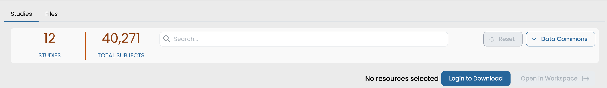
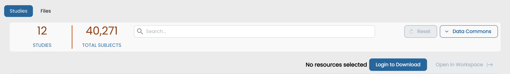
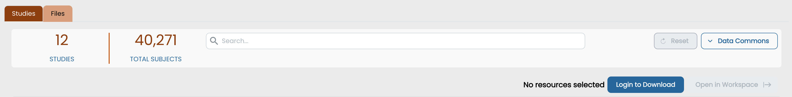

## Discovery Page Configuration Guide

This guide outlines how to configure the Discovery Page of an application, focusing on browsing and searching metadata. The Discovery Page can be tailored through JSON configuration files to enhance user interaction and data discovery capabilities.

### 1. Overview of Configuration Structure

The configuration for the Discovery Page is divided into several sections:
- `tableConfig`: Settings related to the display of tabular data.
- `features`: Customizable features for search, filters, and other functionalities.
- `aggregations`: Definitions for data aggregation displayed on the page.
- `studies`: Array for specifying which studies to display (usually dynamically loaded).
- `studyColumns`: Specifications for columns in the studies table.
- `studyPreviewField`: Configuration for previewing study details.
- `detailView`: Detailed view settings for individual studies.
- `tagsDisplayName`: Name for the tag categories displayed.
- `tagColumnWidth`: Width settings for the tag columns.
- `minimalFieldMapping`: Essential field mappings required by the page.
- `tags`: Definitions for the categorization and display of tags.
  - `tagCategories`: Definitions for the categorization and display of tags.
  - `showUnknownTags`: Defaults to False

### 2. Detailed Configuration Sections

#### a. Table Configuration (`tableConfig`)

- **selectableRows**: Boolean to enable selection of rows in tables.
- **expandableRows**: Boolean to allow rows to be expandable for more details.

```json
"tableConfig": {
  "selectableRows": true,
  "expandableRows": true
}
```

#### b. Features (`features`)

Configurable features to enhance the user interface and functionality:

##### Advanced Search Filters

- **enabled**: Toggle the visibility and functionality of advanced search filters.
- **field**: Specifies the internal field to be used for advanced filtering.
- **displayName**: The label shown for the filters in the UI.
- **filters**: An array of filter keys that dictate the available filters.
-

```json
"advSearchFilters": {
  "enabled": true,
  "field": "advSearchFilters",
  "displayName": "Filters",
  "filters": [
    {
      "key": "Study Type"
    },
    {
      "key": "Data Type"
    }
    // More filters...
  ]
}
```

##### AI Search

- **aiSearch**: Enables AI-powered search capabilities.

##### Tags and Export Options

- **tagsColumn**: Controls the display of tags directly within the table.
- **tagsInDescription**: Whether to include tags in descriptions.
- **exportToWorkspace**: Configuration related to exporting data to a workspace.

##### Page Title and Search

- **pageTitle**: Toggle to display the page title.
- **search**: Detailed configurations for search functionalities including a search bar and tag dropdown.

##### Authorization

- **authorization**: Configurations related to data access and permissions.

Example of advanced search filters configuration:

## Multiple Tabs

The Discovery page can be configured to display multiple tabs, each with its own set of filters and aggregations. This
allows users to explore different aspects of the data in a more organized manner. To enable this a configuration for
each tab is placed in an array:

```json
{
  "metadataConfig": [
    {
      "guidType": "discovery_metadata",
      "pageTitle": {
        "enabled": false,
        "text": "Study Discovery"
      },
      ...
      rest
      of
      configuration
    },
    "metadataConfig"
    :
    [
      {
        "guidType": "indexed_files_metadata",
        "pageTitle": {
          "enabled": false,
          "text": "Files"
        },
        ...
        rest
        of
        configuration
      }
  ]
}
```

In this case the "pageTitle" member is the label for the tab. As shown in the image below:


### Tab Styles

To set tab styles, add a   "tabType": "pills",


or 'tabType': 'outline'


### Organizing data for tabs

The preferred method to served difference metadata by tab is to create different `guidType` types and load data
accordingly. This way, each tab will have a separate `guidType` and loads only that data from the metadata service.

### Authorization to Tabs

Optionally you can add authorization to the tabs by adding an "authz" member as:

```json
{
  "metadataConfig": [
    {
      "guidType": "discovery_metadata",
      "authz": [
        "/see_studies"
      ]
    },
    ...
    rest
    of
    configuration
  ]
}
```

Is a user is not authorized to see the tab it will not be shown. The resource uses the aborist rules
engine to determine authorization, so a user authorized to access a parent resource path will be allowed to see the tab.

## Aggregations (`aggregations`)

- Defines how data should be aggregated on the page, such as count of studies.

```json
"aggregations": [
  {
    "name": "Studies",
    "field": "_hdp_uid",
    "type": "count"
  }
]
```

#### d. Study Columns (`studyColumns`)

- Configurations for each column in the studies table, including name, field, and display settings.

```json
"studyColumns": [
  {
    "name": "Project Title",
    "field": "study_metadata.minimal_info.study_name",
    // Additional settings.svg...
  }
  // More columns...
]
```

#### e. Detail View (`detailView`)

- **headerField**: Field used for the header in the detail view.
- **tabs**: Array of tab configurations, each containing groupings of fields and information.

```json
"detailView": {
  "headerField": "study_metadata.minimal_info.study_name",
  "tabs": [
    {
      "tabName": "Summary",
      "groups": [
        {
          "header": "Study Description Summary",
          "fields": [
            {
              "type": "block",
              "sourceField": "study_metadata.minimal_info.study_description"
            }
          ]
        }
        // More groups and fields...
      ]
    }
    // More tabs...
  ]
}
```
